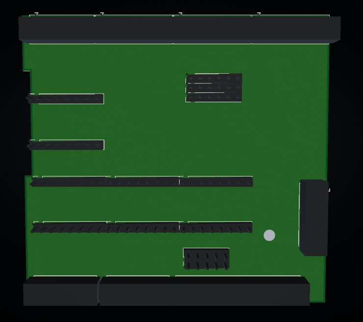
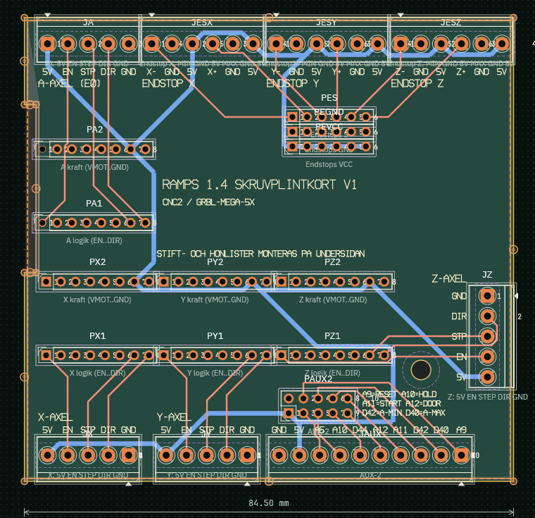

# RampsTerminalHat

A screw-terminal "hat" that plugs on top of a **RAMPS 1.4** and breaks out the stepper-driver
sockets, endstops and AUX-2 to 3.5 mm screw terminals. It is made for running external
step/dir drivers (e.g. Leadshine M542) with **grbl-Mega-5X** on an Arduino Mega, but works for
any RAMPS setup where the Pololu-style driver modules are removed.

Designed in **[PCBCraft](https://github.com/wdunn001/pcbcraft)**, an open-source EDA tool written in Rust.
Open `hardware/RampsTerminalHat.pcbcraft` in PCBCraft to edit the design.

> **This project was generated entirely with [Claude](https://claude.com/claude-code)**
> (Claude Code, Claude Opus 5.5). The schematic, placement, routing, silkscreen, Gerbers,
> fit template, BOM and this README were all produced by Claude driving [PCBCraft](https://github.com/wdunn001/pcbcraft)
> through its MCP server. The design has passed DRC but has **not yet been built and tested**. Check it
> yourself before ordering.

*3D view (parts shown as placeholder boxes).*

*Copper and silkscreen. Blue = bottom copper, red = top copper.*

## Features

- 4 axes: **X, Y, Z, E0 (A)**. Each gets a 5-pole terminal with `5V EN STEP DIR GND`.
- **6 endstops** (X−/X+, Y−/Y+, Z−/Z+). Each axis gets a 6-pole terminal with `MIN GND 5V MAX GND 5V`.
- **AUX-2** on a 10-pole terminal: `GND 5V A5 A10 D44 A12 A11 D42 D40 A9`.
- No PCB over the **F1/F2 fuses** near the USB connector.
- A notch on the left edge so the board does not hit the tall **MOSFETs Q1–Q3**.
- One M3 mounting hole.
- 84.5 × 80 mm, 2 layers, 1.6 mm, through-hole only.

## Pinout (grbl-Mega-5X, `CPU_MAP_2560_RAMPS_BOARD`)

| Terminal | Signals (as printed on silkscreen) | Mega pins |
|---|---|---|
| JX | 5V EN STEP DIR GND | EN D38, STEP A0, DIR A1 |
| JY | 5V EN STEP DIR GND | EN A2, STEP A6, DIR A7 |
| JZ | 5V EN STEP DIR GND | EN A8, STEP D46, DIR D48 |
| JA (E0) | 5V EN STEP DIR GND | EN D24, STEP D26, DIR D28 |
| JESX | X− GND 5V X+ GND 5V | D3 / D2 |
| JESY | Y− GND 5V Y+ GND 5V | D14 / D15 |
| JESZ | Z− GND 5V Z+ GND 5V | D18 / D19 |
| JAUX | GND 5V A5 A10 D44 A12 A11 D42 D40 A9 | A9 reset, A10 feed hold, A11 cycle start, A12 safety door, D42/D40 A-axis limits, A5 and D44 free |

For common-cathode drivers, wire STEP → PUL+, DIR → DIR+ and GND → PUL−/DIR−.

## Bill of materials

All parts are from [Electrokit](https://www.electrokit.com) (Sweden). See [`fabrication/BOM-electrokit.csv`](fabrication/BOM-electrokit.csv).

| Ref | Part | Electrokit # | Qty |
|---|---|---|---|
| PX1–PA2 (8× 1x08) | Pin header 2.54 mm 1x40, breakable. Cut into 8× 8 pins. | [41001167](https://www.electrokit.com/stiftlist-2.54mm-1x40p-brytbar) | 2 |
| PES, PEGND, PEVCC | Female header 2.54 mm 1x6 | [41010579](https://www.electrokit.com/hylslist-2.54mm-1x6p) | 3 |
| PAUX2 | Female header 2.54 mm 2x5 | [41002755](https://www.electrokit.com/hylslist-2.54mm-2x5p) | 1 |
| JX JY JZ JA JESX JESY JESZ JAUX | Screw terminal 3.5 mm, 3-pole | [41016488](https://www.electrokit.com/skruvplint-3.5mm-3-pol-bla) | 12 |
| JX JY JZ JA JAUX | Screw terminal 3.5 mm, 2-pole | [41016487](https://www.electrokit.com/skruvplint-3.5mm-2-pol-bla) | 6 |

The footprints are 5-, 6- and 10-pole 3.5 mm terminals (Phoenix PT 1,5). Electrokit only sells
2- and 3-pole blocks, so place them side by side:
- 5-pole = 3 + 2
- 6-pole = 3 + 3
- 10-pole = 3 + 3 + 2 + 2

Any other 3.5 mm pitch terminal blocks with 1.2 mm pins will fit too.

## Assembly

1. Solder the **screw terminals on the top side**.
2. Mount the **pin headers and female headers on the bottom side**, so they point down into the RAMPS. Solder them from the top.
3. The driver-socket pins hold the board about 11 mm above the RAMPS. Standard 8.5 mm female headers then reach the endstop and AUX-2 pins.
4. Remove all stepper driver modules from the RAMPS before fitting the board.

### Fit template

[`fit-template/`](fit-template) holds a 3D-printable template (STL/3MF) with the same outline,
holes and header positions as the board. There is also a 1:1 PDF drawing. Print it and test-fit
it on your RAMPS before you order PCBs.

## Ordering PCBs

**Upload [`fabrication/RampsTerminalHat-JLCPCB.zip`](fabrication/RampsTerminalHat-JLCPCB.zip) as it is.**
It contains every file JLCPCB needs, so you don't have to unpack it or add anything:
- copper, solder mask and silkscreen for both sides
- the board outline
- the plated and non-plated drill files

On jlcpcb.com, click *Order now* → *Add gerber file* and select the zip. The other fabs that
accept Gerber zips (PCBWay, Aisler, …) work the same way.

Order 2 layers, 1.6 mm, HASL, 1 oz. Check in the Gerber viewer that the outline is 84.5 × 80 mm
and that the notch is there.

The raw PCBCraft Gerber output, including the job file and drill table, is in [`gerber/`](gerber).

## Files

| Path | Contents |
|---|---|
| `hardware/RampsTerminalHat.pcbcraft` | [PCBCraft](https://github.com/wdunn001/pcbcraft) design file |
| `gerber/` | Gerber X2 + Excellon output |
| `fabrication/` | Complete upload zip for JLCPCB, and the BOM |
| `fit-template/` | 3D-printable fit template and PDF |
| `docs/` | Images |

## Credits

The RAMPS 1.4 connector positions were taken from
[matt3u/RAMPS-1.4_KiCad](https://github.com/matt3u/RAMPS-1.4_KiCad).
